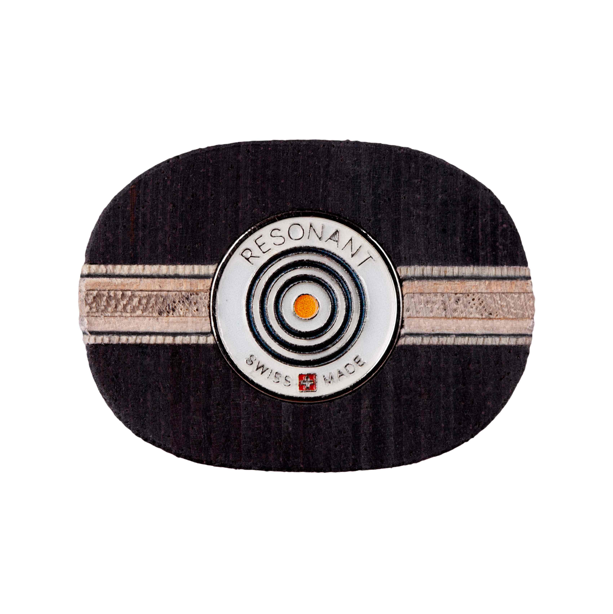

# 🏓 Interactive 3D Table Tennis Blade Product Page (Three.js & WebGL)

[](https://dev.to/shahibur_rahman_6670cd024/interactive-3d-table-tennis-blade-configurator-with-threejs-complete-in-depth-tutorial-3lg9)
[](https://shahisoft.com/fl/resonant/)
[](https://threejs.org/)

A high-performance, photorealistic 3D product configurator built for table tennis blades using **Three.js**, **WebGL**, **WebAssembly CAD parsing (`occt-import-js`)**, and custom **GLSL Shaders**. Designed as a zero-dependency frontend stack that integrates seamlessly as a standalone WordPress / WooCommerce plugin.

---

## 📽️ Demo & Screenshots

### Video Preview
Check out the feature walkthrough video in the repository:
> `assets/demo.mov` *(or see the live demo link below)*

| Front View | Handle Butt (Logo Decal) |
| :---: | :---: |
|  |  |

---

## 📖 Complete Technical Tutorial

For a deep-dive breakdown into how this configurator was built from scratch—including CAD alignment, shader material creation, UV texture mapping, and frame-rate optimization—read the full article on Dev.to:

👉 **[Read the Complete In-Depth Tutorial on Dev.to](https://dev.to/shahibur_rahman_6670cd024/interactive-3d-table-tennis-blade-configurator-with-threejs-complete-in-depth-tutorial-3lg9)**

---

## ✨ Key Features

- **Direct STEP CAD Parsing:** Reads and renders raw `.step` files (`assets/Flared.step`) in real-time inside the browser via WebAssembly (`occt-import-js`) without prior conversion.
- **Strict Geometry Clipping:** Keeps the blade core and half-handle geometries completely separate, ensuring handle wood patterns never bleed onto the blade face.
- **Photorealistic Materials & Lighting:** Custom GLSL shader programs with physically based rendering (PBR), ACES filmic tone mapping, and PMREM environment lighting.
- **Instant Material Swapping:** Preloads shaders and textures directly on the GPU for zero-latency switching between handle finishes.
- **Interactive Camera Presets:** Instant camera navigation for `Front`, `Back`, `Edge`, and inspectable `Handle Butt`, alongside auto-rotating 360° mode and full-screen support.
- **Decal Engine:** Auto-masked logo decals applied dynamically to the handle end-cap.
- **Performance Optimized:** Built with zero build steps, capped at 2x device pixel ratio, with on-demand rendering loops to prevent mobile battery drain.

---

## 🛠️ Tech Stack & Libraries

* **3D Engine:** Three.js (r160)
* **CAD Loader:** `occt-import-js` (OpenCASCADE compiled to WebAssembly)
* **Shaders:** GLSL (Vertex & Fragment Shader extensions)
* **Lighting:** `RoomEnvironment` PMREM Generator & Directional Key Lighting
* **Platform:** Native Vanilla JavaScript / HTML5 / CSS3 (WordPress / WooCommerce plugin compatible)

---

## 📂 Repository Assets Structure

├── assets/
│   ├── Flared.step         # Original STEP CAD file
│   ├── flared-blade.gltf   # GLTF fallback asset
│   ├── Blade 1.jpg         # Front blade wood face texture
│   ├── Blade 3.jpg         # Back blade wood face texture
│   ├── Handle 2.jpg        # Multi-layer handle wood texture
│   ├── logo.jpg            # Brand logo decal image
│   └── demo-video.mp4      # Walkthrough video of the configurator
├── index.html              # Standalone 3D Viewer & App Code
└── README.md

---

## 🚀 Quick Start / Local Setup

Because this project uses ES Modules, WebAssembly (`occt-import-js`), and web workers, it must be served over a local HTTP server:

1. **Clone the repository:**
   ```
   git clone https://github.com/d5b94396feba3/Interactive-3D-Table-Tennis-Blade-Product-Detail-Page-Threejs
   cd Interactive-3D-Table-Tennis-Blade-Product-Detail-Page-Threejs
Serve locally using Python or Node.js:


# Using Python 3
python -m http.server 8000

# Or using npx serve
npx serve .
Open in browser:
Navigate to http://localhost:8000

📝 License & Attribution
Tutorial & Developer: Shahibur Rahman

Open source libraries (Three.js, occt-import-js) belong to their respective copyright holders under the MIT license.
